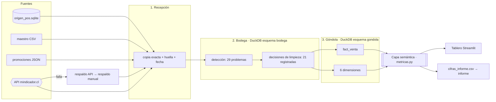

# Arquitectura de integración y operación de la cadena

Insumo para la sección B del informe. Las cifras entre corchetes (`[RBA_90]`) se reemplazan por su valor en `salidas/cifras_informe.csv`.

## 1. Pasos de la cadena y por qué cada transformación está donde está

Los nombres vienen del rubro: la mercadería se **recibe** en el andén, se revisa y ordena en la **bodega** y se expone en la **góndola**.

| Paso | Transformación | Por qué aquí y no en otro paso |
|---|---|---|
| 1. Recepción | Ninguna: copia byte a byte, huella SHA-256, conteo de filas, fecha de recepción | Lo crudo se conserva intacto: se puede auditar y volver a transformar sin pedir de nuevo la fuente |
| 2. Bodega | Fechas en 4 formatos → fecha estándar; números como texto → números; duplicados, fuera de período, signo, montos, categorías | La limpieza depende de evidencia de todo el conjunto (por ejemplo, el orden día-mes); se decide una vez, antes del modelo |
| 3. Góndola | Claves sustitutas, grano de línea, campaña de cada línea, pesos reales (IPC) | El modelo asume datos limpios; separarlo permite probar claves y huérfanos sin mezclar con la limpieza |
| Capa semántica | Cliente activo, RBA, reposición, NNV, retención trimestral, caso de negocio | La definición se escribe una vez y la consumen el informe y el tablero |

## 2. Tres decisiones

**ELT, no ETL.** Primero se carga la copia cruda (paso 1) y después se transforma (pasos 2 y 3). Con fuentes sucias (fechas en cuatro formatos,
62 boletas duplicadas, montos con recargo), transformar al vuelo obliga a decidir antes de ver el conjunto completo y, si falla, no queda
qué revisar. Guardando crudo, cambiar una decisión de limpieza solo requiere volver a correr desde la copia.

**Carga completa, no incremental.** Cada corrida reemplaza todas las tablas (`CREATE OR REPLACE`): correr dos veces no duplica y un dato
corregido en el origen entra en la siguiente corrida. Con [BOLETAS_ORIG] boletas la cadena demora unos 6 segundos. Además se construye en un
archivo nuevo y solo reemplaza al publicado si todas las pruebas bloqueantes pasan, así que el tablero nunca ve una carga a medias.
Pasaríamos a incremental (cargar solo boletas nuevas por fecha y `boleta_id`, con una tabla de control de la última carga) cuando la carga
completa deje de caber en la ventana de actualización, del orden de millones de boletas por corrida.

**Si falla una fuente.** La API del IPC se consulta en cada corrida. Si no responde o la serie no trae 12 meses válidos:
1. se usa la última respuesta buena de la API (`data/fuentes/ipc_2025_respaldo_api.json`), y si no existe, el respaldo manual con valores del INE;
2. la prueba F07 queda en *avisa*, el log lo registra (`salidas/cadena.log`, se archiva) y la corrida queda marcada con la fuente usada;
3. el tablero muestra un aviso amarillo y el pie dice "IPC: respaldo de la API (fecha)". Las métricas de retención no cambian (cuentan clientes); solo los pesos reales.

Si falla el POS, el maestro o las promociones, la cadena se **detiene** (pruebas F01–F06 bloquean) y el tablero sigue mostrando la última
corrida buena con su fecha. Probado con `python run.py --sin-api`.

## 3. Pruebas de calidad (corren en cada ejecución)

Resultado de la última corrida en `salidas/resultados_pruebas.csv` y en el pie del tablero. Historial en `operacion.pruebas`.

| Código | Paso | Qué verifica | Si falla |
|---|---|---|---|
| F01 | recepción | La base del POS existe | bloquea |
| F02 | recepción | El POS trae las 7 tablas esperadas | bloquea |
| F03 | recepción | Boletas y detalle no vienen vacíos | bloquea |
| F04 | recepción | El maestro de productos existe | bloquea |
| F05 | recepción | El maestro trae las 9 columnas esperadas | bloquea |
| F06 | recepción | El JSON de promociones se lee y trae campañas | bloquea |
| F07 | recepción | La API del IPC respondió con 12 meses válidos | avisa (usa respaldo) |
| M01 | góndola | Clave del hecho (boleta_id, linea_n) única | bloquea |
| M02-* | góndola | Clave sustituta única en cada dimensión (5) | bloquea |
| M03-* | góndola | Sin huérfanos: cada clave del hecho existe en su dimensión (7, incluye las dos fechas) | bloquea |
| M04 | góndola | Todas las fechas dentro de 2025 | bloquea |
| M05 | góndola | Montos de línea positivos | bloquea |
| M06 | góndola | Todo monto tiene factor IPC | bloquea |
| M07 | góndola | Líneas sin costo bajo 5% | avisa |
| Q01 | métrica | RBA entre 0% y 100% | bloquea |
| Q02 | métrica | La base activa no está vacía | bloquea |
| Q03 | métrica | Retenidos + perdidos = base activa | bloquea |
| Q04 | métrica | Excluidas + usadas = boletas originales | bloquea |
| Q05 | métrica | Completitud ≥ 85% (SLA) | avisa |
| Q06 | métrica | NNV entre 0% y 100% | bloquea |

Además, la detección del paso 2 deja 29 problemas de calidad medidos (uno por archivo en `salidas/calidad/`), y el código tiene dos controles
internos que detienen la corrida: el control de magnitud del precio (si la interpretación del punto como separador de miles falla) y las
categorías sin resolver.

## 4. Linaje de la métrica

| Campo que entra en la métrica | Fuente | Transformación (paso) | Pantalla que lo consume |
|---|---|---|---|
| `fact_venta.cliente_key` | POS `boletas.cliente_id` | anónimo → clave 0; clave sustituta (góndola) | todas las cifras de retención |
| `fact_venta.fecha_key` | POS `boletas.fecha` (4 formatos) | orden día-mes decidido con los datos; fuera de 2025 excluido (bodega) | RBA, reposición, trimestral, NNV |
| `fact_venta.fecha_alt_key` | POS `boletas.fecha` | lectura mes-día solo de las fechas ambiguas (bodega) | filtro "Lectura de las fechas" |
| `boleta_id` (degenerada) | POS `boletas.boleta_id` | duplicados exactos eliminados; boletas con monto ≤ 0 excluidas (bodega) | conteo de visitas |
| `dim_cliente.fecha_alta` | POS `clientes.fecha_alta` | formatos mixtos → fecha (bodega) | "cliente nuevo" (inicio de relación) |
| `fact_venta.monto_nominal` | POS `boleta_detalle.monto_linea` | texto → número; recargos recalculados; signo corregido (bodega) | caso de negocio, trimestral |
| `fact_venta.monto_real_dic` | monto × IPC (API) | variaciones encadenadas → factor a pesos de dic (góndola) | caso de negocio |
| `fact_venta.margen_nominal` | monto − cantidad × `maestro.costo_unitario` | costo texto → número; SKU repetido → registro activo (bodega) | margen no capturado, contacto en riesgo |
| `dim_tienda.formato` | POS `tiendas.formato` | "Hiper" → "Híper" (góndola) | corte por formato |

## 5. Acuerdo de servicio de `fact_venta`

| Dimensión | Compromiso | Cómo se mide | Última corrida |
|---|---|---|---|
| Frescura | Se actualiza al menos una vez al mes, al cierre mensual (≤ 31 días) | fecha de la última corrida OK (pie del tablero) | ver `operacion.ultima_corrida` |
| Completitud | ≥ 85% de las boletas originales llega a la métrica | prueba Q05 | [100 − PCT_EXCLUIDAS]% |
| Calidad | 100% de las pruebas bloqueantes en verde; las de aviso se informan | `pct_bloqueantes_ok` en `operacion.corridas` | ver `resultados_pruebas.csv` |
| **Dueño** | **Gerente Comercial** (responde por las definiciones); operación de la cadena: analista de BI de la cadena | | |
